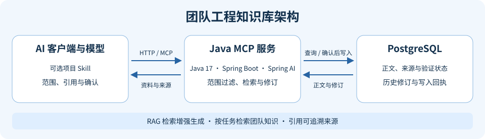

# Team Knowledge MCP

[中文说明](README.zh-CN.md)

Team Knowledge MCP is a self-hosted engineering knowledge base. Teams store development standards, business rules, past defects, code notes, Git branch history, script references, and SQL lessons in PostgreSQL. AI clients retrieve relevant records through MCP and use them as context for retrieval-augmented generation (RAG). This helps the model understand requirements, follow applicable standards, and produce answers with traceable sources.

Team members can share lessons from features, fixes, and customer-specific changes. That reduces the need to repeat background or paste the same references into each task. Provide the actual requirements, target version, and deployment differences for each task.



## How it works

- **AI client and model** interpret the question, select tools, read the retrieved material, and compose the answer.
- **Optional project Skill** gives the client rules for finding the right scope, ordering searches, citing sources, and asking for user confirmation. Teams can maintain these instructions in their own client.
- **Java MCP service** exposes Streamable HTTP tools for scope discovery, keyword and code identifier search, source lookup, and revision history. MCP is read-only by default. If an administrator enables writes, clients with access can submit ordinary knowledge revisions after human confirmation. Formal standards are maintained through the local admin command.
- **PostgreSQL knowledge base** stores text, source references, verification status, and revision history. Teams can prepare Markdown and metadata locally and use the admin command to import records. Normal queries retrieve stored records from PostgreSQL.

Records can be filtered by system, module, customer, product version, Git branch, and database vendor. Use `GLOBAL` for confirmed shared applicability within a dimension. Use separate instances and databases for teams requiring separate access.

## What teams use it for

- Explain how a feature works in a particular version and compare customer-specific variants.
- Find source files and scripts, review similar defects, and retrieve applicable standards before coding.
- Review requirements, identify affected components and constraints, and propose an implementation plan.

Use the retrieved material as engineering background. Before changing code, check the target repository and run relevant tests. Verify deployment behavior separately.

## Quick start

Install Java 17, Maven 3.6.3 or newer, and Docker with Compose. Alternatively, create an empty, dedicated PostgreSQL database and set the connection variables in the table below.

1. Copy `.env.example` to `.env` and set a strong alphanumeric database password. The same file is read by Docker Compose and by the application when started from this directory.
2. Start the development database and build the JAR.

   ```sh
   docker compose up -d --wait db
   mvn verify
   ```

3. Apply the initial schema when starting the application against the dedicated database.

   ```sh
   java -jar target/team-knowledge-mcp-0.1.0.jar --spring.flyway.enabled=true
   ```

   Later starts can omit the flag until you intentionally apply another migration. The Compose volume persists the database between runs.

4. In another terminal in the project directory, import a fictional record using the local administrator command.

   ```sh
   java -jar target/team-knowledge-mcp-0.1.0.jar admin --apply=true --action=import --root=examples --file=order-retries.json
   ```

5. Add `http://127.0.0.1:18765/mcp` to an MCP client that supports Streamable HTTP. Start with `discover_knowledge_scopes` using `{}` as the string argument `request_json`. For a focused search, pass the contents of [examples/search.json](examples/search.json) as `request_json` to `search_knowledge`. Ask your client for the record about order retry behavior and verify that it cites the fictional source file. The HTTP readiness endpoint is `GET /actuator/health` and checks database connectivity. A successful health response alone does not establish that a query or migration succeeded.

## Configuration

| Variable | Default | Purpose |
| --- | --- | --- |
| `TEAM_KB_DB_URL` | Local PostgreSQL on port 55432, database `team_knowledge` | JDBC URL for the dedicated database |
| `TEAM_KB_DB_USER` | `team_knowledge` | PostgreSQL application role |
| `TEAM_KB_DB_PASSWORD` | Empty | Set locally or via a secret manager |
| `TEAM_KB_MIGRATE` | `false` | Opt in to Flyway migrations at startup |
| `TEAM_KB_BIND_ADDRESS` | `127.0.0.1` | HTTP listener address |
| `TEAM_KB_PORT` | `18765` | HTTP port |
| `TEAM_KB_MCP_TOKEN` | Empty | Shared bearer credential for trusted clients |
| `TEAM_KB_ALLOWED_HOSTS` | Loopback hostnames | Additional comma-separated hostnames or IP addresses |
| `TEAM_KB_WRITE_ENABLED` | `false` | Advertise and enable the MCP experience write tool |

The default listener is local. For team access, use a restricted network or an authenticated HTTPS proxy and supply a randomly generated bearer token. Set explicit allowed hostnames when using a non-loopback listener and configure the proxy to pass the intended Host and Authorization headers. Non-loopback startup requires a token of at least 32 characters. The shared token grants access to the instance. Use separate instances and databases for teams requiring separate access. Keep the development database port on loopback. Use a dedicated role with only the database permissions needed for your deployment.

## Working with knowledge

- Discover scope combinations before selecting a scope, then run `search_knowledge`. Set `include_unverified=true` for explicitly unverified notes, including the example.
- Read a record with `get_knowledge_detail` and cite its source repository, path, and revision when available. Treat retrieved text as reference material.
- To import your own notes, adapt the example JSON and replace the scope, text, and source evidence. Administrative `--markdown=FILE` can supply the Markdown body and compute its SHA-256. The server does not pull or crawl repositories.
- The local `admin` command can publish formal standards and restore historical revisions. Enabling MCP writes exposes `save_knowledge` to shared clients for ordinary entries. Review scope and content with a human first. The server records the submitted confirmation and verification claims. It cannot verify who actually approved them.
- Run `java -jar target/team-knowledge-mcp-0.1.0.jar reindex --apply=true` to rebuild search chunks without changing knowledge revisions.

## Development

Run `mvn verify` for unit tests and the executable JAR. To run the PostgreSQL tests too, set `TEAM_KB_TEST_DB_URL`, `TEAM_KB_TEST_DB_USER`, and `TEAM_KB_TEST_DB_PASSWORD`. The URL must select a disposable database whose name starts with `team_knowledge_test`. The tests migrate it and write fictional test records. The GitHub Actions workflow supplies its own PostgreSQL service.

See [README.zh-CN.md](README.zh-CN.md) for the Chinese quick start.
