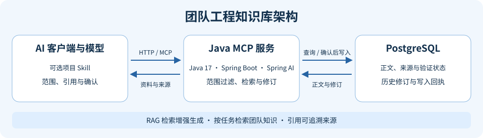

# Team Knowledge MCP

面向开发团队的自托管工程知识库。团队可以把工程规范、业务规则、历史缺陷、代码说明、分支记录、脚本索引和 SQL 经验统一存入 PostgreSQL。AI 客户端通过 MCP 按需检索，用 RAG（检索增强生成）补充项目背景，辅助理解需求、遵循开发规范，并提供可核对的来源。

团队成员可以持续分享功能开发、缺陷修复和定制经验，减少反复介绍项目背景和粘贴资料。每次任务仍需提供实际需求、目标版本及现场差异。

## 工作原理

- **AI 客户端和模型**理解问题、选择工具、阅读资料并组织答案。
- **可选的项目 Skill**由团队在客户端侧维护，约定如何发现适用范围、查询、引用来源，以及何时向用户确认。
- **Java MCP 服务**通过 Streamable HTTP 提供范围发现、关键词检索、来源读取和修订历史查询。默认只开放查询。管理员启用写入后，有访问权限的客户端可在用户确认后提交普通知识修订。正式规范通过本地管理命令维护。
- **PostgreSQL 知识库**保存正文、来源、验证状态和历史修订。团队可以在本地整理 Markdown 与元数据，再通过管理命令导入。日常问答从数据库检索。

知识可以按系统、模块、客户、产品版本、Git 分支和数据库类型筛选。GLOBAL 表示在对应维度已确认通用。需要隔离团队访问时，为团队分别部署服务和数据库。

## 适合解决的问题

- 解释指定版本的业务逻辑，比较客户定制差异。
- 定位代码和脚本，回顾类似缺陷，开发前查阅适用规范。
- 评估需求文档，梳理受影响的模块和约束，提出开发方案。

知识库提供开发前的参考。修改代码前应核对目标仓库和相关测试，现场部署行为另行验证。

需要 Java 17、Maven 3.6.3+ 和 Docker Compose。也可以在已有 PostgreSQL 上准备一个专用空库，并通过 TEAM_KB_DB_URL 等环境变量指定连接。

1. 复制 .env.example 为 .env，填写独立的数据库密码。
2. 执行 `docker compose up -d --wait db`，再执行 `mvn verify`。
3. 执行 `java -jar target/team-knowledge-mcp-0.1.0.jar --spring.flyway.enabled=true`，首次启动时显式创建表。
4. 另开一个终端，在项目目录执行 `java -jar target/team-knowledge-mcp-0.1.0.jar admin --apply=true --action=import --root=examples --file=order-retries.json`，导入一条虚构的演示知识。
5. 在支持 Streamable HTTP 的 MCP 客户端填写 `http://127.0.0.1:18765/mcp`。先发现真实知识范围，再用 examples/search.json 提供的范围和关键词检索。

默认监听本机，MCP 默认只开放查询。团队部署通过受限网络或 HTTPS 代理访问，设置允许的主机和随机访问令牌。默认数据为空，团队按自身项目、模块、客户、版本、分支和数据库口径维护资料。完整配置、维护方式及测试说明见 [README.md](README.md)。
